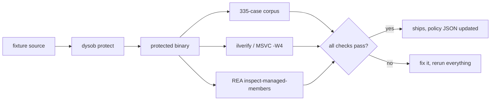

# Dysphasia

[](https://github.com/UltiNight/Dysphasia/actions/workflows/verify.yml)
[](LICENSE)

A small Windows program, built on purpose, with an AI reverse-engineering agent pointed at it to see what actually comes back.

[plain-language overview](OVERVIEW.md) | [benchmarks](BENCHMARKS.md) | [contributing](CONTRIBUTING.md) | [changelog](CHANGELOG.md) | [author's afterword](AFTERWORD.md)

## What this is

[REA](https://github.com/morluto/rea) ("Reverse Engineer Anything") is an AI agent that reverse-engineers binaries: decompile, trace, recreate, roughly in that order. This repo builds a small fixture program (`PixelTone`, about 115 lines of C#/C), runs REA against it, and then adds obfuscation passes one at a time to see what each one actually costs an AI-driven analyst. Not what obfuscation theory says it should cost, but what it measurably costs against this specific tool, checked every time a pass gets added.

Every pass here has to clear four gates before it ships: byte-for-byte match against the unprotected baseline across a 335-case behavioral corpus, a clean pass from `ilverify` (or `/W4` with zero warnings on the native side), the same output bytes on a repeat build with the same seed, and a before/after REA measurement. If a technique can't clear all four, it either doesn't go in the policy file, or it goes in with the failure written down rather than quietly left out.

The point isn't to make the program impossible to understand. Nothing that actually runs is impossible to understand, given enough time and patience. The point is to make reconstruction cost more, in both time and accuracy, than it's worth. A time-fight, not a wall.

That split matters more than it sounds like it should. Five independent reconstruction attempts against an early, lightly-protected build averaged 2.18x the unprotected baseline's time and still got 334 of 335 behavioral test cases right, every time. The same experiment run later against the actual strongest build (all 18 passes) barely cost more time (2.41x) but accuracy fell off a cliff: average corpus pass rate dropped from 99.9% to 44.4%, and none of the five reconstructions were fully correct. Full protection doesn't mostly slow an analyst down. It mostly makes them wrong. See [the benchmarks](BENCHMARKS.md#independent-reconstruction-two-rounds-of-n5) for both rounds side by side.

## Why bother

REA and tools like it change what reverse engineering costs. Work that used to take a skilled analyst an afternoon can now be attempted automatically, in minutes, for nothing. Most obfuscation writing is aimed at human analysts staring at a disassembler. This project asks a narrower question: for this specific kind of AI tool, which of the classic tricks still hold up, which don't, and by how much?

Some of what's here are negative results, and they're kept on purpose. Token bloating doesn't work against REA, because it paginates its output, so stuffing the assembly with junk classes doesn't blow its context window the way it might for a tool that doesn't. Hiding `IsDebuggerPresent` behind dynamic API resolution doesn't prove anything either, because the C runtime already imports it on its own, independent of this program's code. Both are documented in [the benchmarks](BENCHMARKS.md#what-didnt-work) instead of dropped from the writeup, because a benchmark that only reports the wins isn't telling you anything.

## How it's put together



`dysob`, under `tools/obfuscator/`, is a Mono.Cecil-based IL rewriter. A JSON policy file lists which passes run and in what order, and order turns out to matter more than it looks like it should. Function inlining has to run before control-flow flattening, for example, or the flattening dispatcher drops values that were sitting on the evaluation stack when it treats the newly-inlined call site as a block boundary. (This was a real bug, not a hypothetical. See the list further down.) The native track reimplements the same ideas by hand in a C port of the program and compiles it with MSVC. There's no IL to rewrite on that side, so it's source-level transformation all the way through.

## What's actually in here

The list below comes from a catalogue of roughly 30 classic obfuscation and anti-analysis techniques across five categories. A checkmark means it's implemented and measured; an X means it was looked at and deliberately left out, with a reason. The report links go to the technical writeups: implementation notes, bugs hit along the way, verification, and an honest accounting of what the technique doesn't do.

### Lexical & data

| Technique | Status | Notes |
|---|---|---|
| Identifier mangling | done | the `rename` pass |
| Deceptive naming / semantic poisoning | done | [deceptive-naming-homoglyphs.md](reports/deceptive-naming-homoglyphs.md) |
| String encryption | done | [bcl-call-hiding.md](reports/bcl-call-hiding.md), the `string-encode` pass |
| String splitting | done | [string-splitting.md](reports/string-splitting.md): turns out to add less on top of encryption than you'd hope |
| Mixed Boolean-Arithmetic | done | [mba-constants.md](reports/mba-constants.md) |
| Variable splitting/merging | done | [variable-splitting.md](reports/variable-splitting.md) |
| Pointer aliasing | done, native only | [native-loop-unroll-pointer-alias.md](reports/native-loop-unroll-pointer-alias.md) |
| Garbage data | done | [garbage-data.md](reports/garbage-data.md) |

### Control flow

| Technique | Status | Notes |
|---|---|---|
| Control-flow flattening | done | [opaque-predicates-and-cff-fix.md](reports/opaque-predicates-and-cff-fix.md): this one shipped with a real bug for a while, see below |
| Opaque predicates / bogus control flow | done | same report |
| Function inlining | done | [function-inlining.md](reports/function-inlining.md) |
| Function outlining | done | [function-outlining.md](reports/function-outlining.md) |
| Loop unrolling | done, native only | [native-loop-unroll-pointer-alias.md](reports/native-loop-unroll-pointer-alias.md) |
| Exception-based routing | done | [exception-routing-dotnet.md](reports/exception-routing-dotnet.md), [native-exception-routing.md](reports/native-exception-routing.md) |
| Dynamic API resolving | done, native only | [native-anti-debug-dynamic-api.md](reports/native-anti-debug-dynamic-api.md) |

### Virtualization & advanced

| Technique | Status | Notes |
|---|---|---|
| Code virtualization (VMP-style) | done, one method only, standalone | [code-virtualization.md](reports/code-virtualization.md): a hand-assembled 8-opcode bytecode VM |
| Self-modifying code | no | needs the program to rewrite its own live code memory; this project doesn't do that anywhere |
| JIT decryption | no | same problem as SMC, one function at a time instead of all at once |
| Environmental entanglement | no | breaks "same seed, same build," which the whole build process leans on |
| White-box cryptography | no | its own research field; overkill for a 115-line program |

### Anti-analysis & integrity

| Technique | Status | Notes |
|---|---|---|
| Anti-debugging | done | [anti-debugging.md](reports/anti-debugging.md) (.NET), [native-anti-debug-dynamic-api.md](reports/native-anti-debug-dynamic-api.md) (native) |
| Integrity checks | done | [integrity-check.md](reports/integrity-check.md): a behavioral self-check rather than a raw file-hash self-patch, which would've meant writing back into an already-written PE at an exact byte offset. Decided that was more risk than this fixture was worth. |
| Anti-disassembly | no | needs raw junk bytes mid-instruction; MSVC x64 dropped inline `__asm` entirely, so this would mean patching the compiled binary directly, which the native track has stayed away from since the start |
| Timing checks | no | there's no threshold that's both short enough to catch someone single-stepping in a debugger and long enough to never misfire against this project's own automated test runs |
| Anti-dump | no | needs the program to corrupt its own PE header at runtime, the same live-memory problem as SMC |
| Anti-VM/sandbox | no | this is standard malware evasion (MITRE ATT&CK T1497); unlike anti-debugging, there's no legitimate commercial-software reason to do it |

### Anti-AI

| Technique | Status | Notes |
|---|---|---|
| Semantic poisoning | done | [deceptive-naming-homoglyphs.md](reports/deceptive-naming-homoglyphs.md) |
| Homoglyph injection | done | same report, only on identifiers that were already private, never used to impersonate a real name |
| MHOP (crypto-gated opaque predicates) | done | [mhop-predicates.md](reports/mhop-predicates.md): gated on `SHA256`, not just arithmetic a human can check by eye |
| Token bloating | shipped, doesn't work | [token-bloating.md](reports/token-bloating.md): REA paginates its output, so this misses its own point. Left in and written up honestly rather than quietly dropped. |
| Prompt injection in code | no | attacks AI safety infrastructure directly, off the table no matter how it's framed |
| Safety guardrail tripping | no | same category |
| Template metaprogramming | no | C++-only, and this project has no C++ track; even with one, it's a source-hardening trick that does nothing against a threat model where REA never sees source |

## Two results that are actually about REA, not obfuscation in general

Most of the table above is "make it harder to read," applied to one binary. Two findings go further than that: they're REA's own tooling missing its own stated job, not just a human having a harder time.

- `inspect-managed-members` resolves method call targets to names (`ArgumentException..ctor`, for instance) but doesn't do the same for exception-handler catch types. Those come back as a bare metadata token with no string anywhere in the output. Found by accident while checking the exception-based-routing pass, not engineered to trip REA specifically.
- `compare-managed-members`, which exists to answer "are these two files the same program," matches 0 of 57 compared methods and fields between the baseline and the fully-protected build. One thing worth being honest about: renaming alone doesn't do this. All 6 original methods still match correctly under pure identifier renaming, three of them byte-for-byte identical, since renaming never touches instruction bytes. It's string encoding that flips it. Once that pass joins the pipeline, matching drops to zero and stays there through everything after. (First guess was that renaming alone would already break this. It didn't. Had to actually run all six intermediate builds to find where it does.) Full writeup in [rea-compare-managed-members.md](reports/rea-compare-managed-members.md).

Both of these came from pointing REA's own commands at REA's own stated job, not from attacking REA as software. That's the same line this project holds on prompt injection and guardrail tripping, both declined above.

## Declined techniques

The "no" rows in the table above all share something: each one got re-argued more than once, under real pressure to build it anyway, and the reasoning never changed. That's a deliberate line, not something left undone. See [CONTRIBUTING.md](CONTRIBUTING.md#the-rules) for what it'd actually take to reopen one of them.

## Bugs found along the way

Nine of them, turned up while building and measuring the passes above. Several had already shipped, already been measured, and were quietly wrong before anyone noticed:

1. Control-flow flattening silently skipped state transitions on unconditional/fallthrough blocks, a `??=` short-circuit bug. The one method in this fixture with a real loop had never actually been flattened in any build before this got fixed.
2. String and BCL-hiding keys were derived from `string.GetHashCode()`, which .NET randomizes per process. "Same seed, same build" had been false for every build that used this pass, since before this project started tracking it.
3. Function outlining could re-extract its own output forever, when the extracted block happened to land exactly at the minimum-size threshold.
4. Integrity-check target detection broke once control-flow flattening pushed the target method past an instruction-count ceiling that had been picked somewhat arbitrarily.
5. Function inlining missed short-form opcodes like `ldarg.0`.
6. The deeper function-inlining bug: a value left on the stack by an inlined call site got silently dropped once control-flow flattening treated that call site as a block boundary. `ilverify`'s "stack underflow" message caught this precisely; the CLR's own `InvalidProgramException` had just been a dead end with no offset to go on.
7. `InitLocals` was never set on methods or locals created by the newer passes. `ilverify` flagged it, though it hadn't caused a crash yet by the time it was caught.
8. Exception-based routing had a stale-index bug: instruction removal was computed by index before an `InsertBefore` shifted every later index, so the removal deleted the wrong half of what had just been inserted.
9. Same pass, a second bug: a nested exception handler needs to be listed before its outer one (ECMA-335 II.25.4.6), and it wasn't. `ilverify` said the module was fine; the actual CLR loader disagreed.

Each one is written up with its root cause and fix in the matching `reports/*.md` file.

## Quickstart

```powershell
Set-Location tools\obfuscator
dotnet build -c Release

# full 18-pass policy against the baseline fixture
dotnet bin\Release\net10.0\dysob.dll protect ..\..\artifacts\baseline\PixelTone.exe `
  --policy policies\pixel-tone.full.json --out ..\..\artifacts\protected-dev

# check it against the 335-case corpus
dotnet bin\Release\net10.0\dysob.dll verify ..\..\artifacts\baseline\PixelTone.exe ..\..\artifacts\protected-dev\PixelTone.exe `
  --corpus ..\..\logs\evaluation01\corpus.json --out ..\..\logs\verify-dev

Set-Location ..\..
& .\artifacts\protected-p1p2p3p5p6p7\PixelTone.exe 64 128 200 10 125 warm
# 70,141,219|8167D285
```

`PixelTone` takes RGB, brightness, contrast, and one of 6 presets, and prints a transformed pixel plus a checksum. [fixture/PixelTone.cs](fixture/PixelTone.cs) has the original source, the answer key that independent reconstruction attempts never got to see.

## Layout

| Path | What's there |
|---|---|
| `fixture/` | original `.cs`/`.c` source, plus the hand-written protected native variants |
| `artifacts/baseline/` | the unprotected reference build |
| `artifacts/protected-*/` | cumulative protected builds, each tied to a policy file and a report |
| `tools/obfuscator/` | `dysob`, the IL rewriter CLI, and every pass |
| `tools/obfuscator/policies/` | JSON pass lists (`pixel-tone.full.json` is all 18 .NET passes) |
| `scripts/` | build, evaluation, and REA-invocation scripts |
| `logs/` | raw REA output and corpus verification results |
| `reports/` | the technical writeups, one per technique or experiment |
| `third_party/rea/` | vendored REA CLI at a pinned commit |
| `BENCHMARKS.md` | the results, with links back to where each number came from |

## License

MIT, see [LICENSE](LICENSE). `third_party/rea/` is vendored under its own license and isn't covered by this one.
